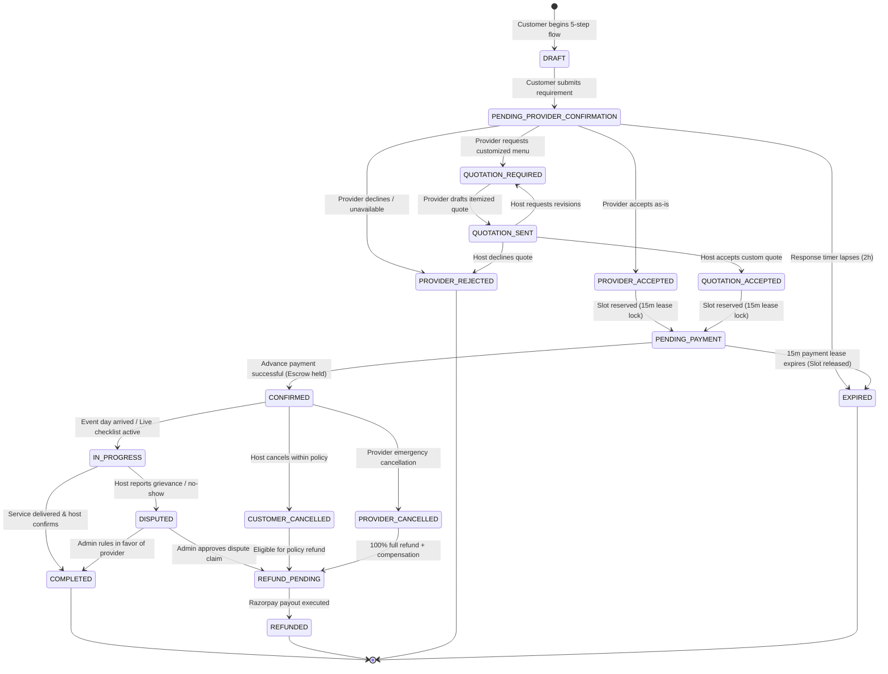

# Booking Workflow & State Machine Specification

**Project:** Culinary & Event Atelier ("BOOK MY CHEF") — Multi-Service Chef, Catering & Event Services Marketplace  
**Engine:** Finite State Machine (FSM) with Server-Side Transition Guards  
**Total Booking States:** 17 Finite States  

---

## 1. Booking State Machine Architecture

Every booking lifecycle is governed by an immutable finite state machine enforced strictly by Spring Boot business logic. Arbitrary status updates from the frontend client are impossible.

---

## 2. Comprehensive State Transition Matrix

| # | Current State | Target State | Authorized Actor | Guard Conditions / Trigger | Side Effects & Actions |
|---|---|---|---|---|---|
| 1 | `DRAFT` | `PENDING_PROVIDER_CONFIRMATION` | Customer | Event date in future; guest count > 0; venue address valid. | Provider notified via push & in-app; 2h countdown timer started. |
| 2 | `PENDING_PROVIDER_CONFIRMATION` | `PROVIDER_ACCEPTED` | Provider | Provider calendar slot is not booked or blocked. | Booking quotation generated; status moved to `PENDING_PAYMENT`. |
| 3 | `PENDING_PROVIDER_CONFIRMATION` | `QUOTATION_REQUIRED` | Provider | Host noted special dietary or custom item requests. | Host notified provider is drafting a custom menu. |
| 4 | `QUOTATION_REQUIRED` | `QUOTATION_SENT` | Provider | Quotation subtotal > 0; itemized lines provided. | Host receives detailed quotation card in chat. |
| 5 | `QUOTATION_SENT` | `QUOTATION_ACCEPTED` | Customer | Host accepts quote total amount. | Concurrency lock acquired on calendar slot; moves to `PENDING_PAYMENT`. |
| 6 | `PENDING_PAYMENT` | `CONFIRMED` | System (Webhook) | Razorpay payment signature verified; 30% advance captured. | Slot locked permanently; funds marked `ESCROW_HELD`; notification sent. |
| 7 | `PENDING_PAYMENT` | `EXPIRED` | System (Worker) | 15 minutes elapsed without successful payment. | Slot released back to `AVAILABLE`; customer notified. |
| 8 | `CONFIRMED` | `IN_PROGRESS` | Provider | Event date equals current date; chef marks checklist "Departed". | Customer live tracking activates; ETA countdown displayed. |
| 9 | `IN_PROGRESS` | `COMPLETED` | Customer / Admin | Host confirms service completion OR 24h pass without dispute. | Escrow released; net funds credited to provider earnings; review unlocked. |
| 10 | `CONFIRMED` | `CUSTOMER_CANCELLED` | Customer | Event date > current timestamp. | Slot released; refund calculated based on cancellation tiers. |
| 11 | `CONFIRMED` | `PROVIDER_CANCELLED` | Provider | Provider emergency cancellation submitted. | 100% refund initiated; provider penalization record created; host offered alternatives. |
| 12 | `IN_PROGRESS` | `DISPUTED` | Customer | Host lodges formal complaint within 24 hours of event. | Escrow payout frozen; case assigned to Operations Admin. |
| 13 | `DISPUTED` | `REFUND_PENDING` | Admin | Operations admin approves refund amount. | Razorpay automated refund dispatched. |
| 14 | `REFUND_PENDING` | `REFUNDED` | System (Webhook) | Razorpay refund webhook confirms bank settlement. | Customer notified; transaction ledger closed. |

---

## 3. Special Family Home-Food Workflow

BOOK MY CHEF provides a dedicated, optimized journey for family gatherings, traditional celebrations (*Pujas, Gruhapravesam, Seemantham*), and home dining.

### 3.1 Workflow Steps
1. **Host Selects Category:** "Home Chefs" -> "Regional Specialists" (e.g., Traditional Andhra Home Feasts).
2. **Host Specifies Gathering Parameters:**
   - Guest Count: 10 to 40 guests
   - Cuisines: Authentic Andhra / Telangana Home Style
   - Traditional Preferences: Pure Ghee preparation, Banana Leaf service, Mild or Andhra Spicy
3. **Choice of Service Delivery Mode:**
   - **Mode A (Chef Visits Home):** The chef arrives 3 hours prior to mealtime with organic spices and cookware, prepares fresh dishes in the host's kitchen, serves warm food, and sanitizes the cooking area before handover.
   - **Mode B (Cook & Deliver):** The chef prepares the dishes in their certified home kitchen and delivers hot banquet-grade insulated thermal containers 30 minutes before mealtime.
   - **Mode C (Custom Menu Order):** Host specifies family heirloom recipes (e.g., specific country chicken curry, traditional gutti vankaya), and chef submits an itemized proposal.

---

## 4. Escrow Financial Mechanics & Cancellation Tiers

### 4.1 Payment Breakdown Structure
- **Booking Advance (30%):** Charged immediately upon quotation acceptance to secure the chef's calendar and fund fresh grocery procurement. Held in platform escrow.
- **Event Balance (70%):** Due on event day upon chef arrival or prior to food service. Held in escrow until host signs off on completion.

### 4.2 Tiered Cancellation & Refund Policy

| Cancellation Window | Customer Refund Percentage | Provider Compensation | Platform Handling Fee |
|---|---|---|---|
| **> 72 hours before event** | 100% of advance | 0% | ₹0 |
| **24 to 72 hours before event** | 50% of advance | 40% of advance | 10% |
| **< 24 hours before event** | 0% (Forfeited) | 85% of advance | 15% |
| **Provider Cancellation** | 100% + ₹500 courtesy voucher | ₹0 (Penalty applied) | ₹0 |
