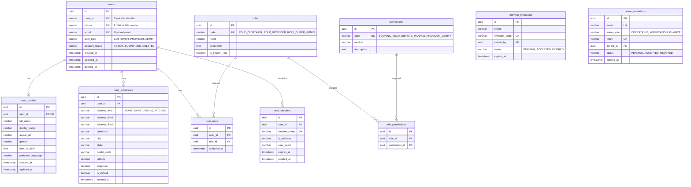
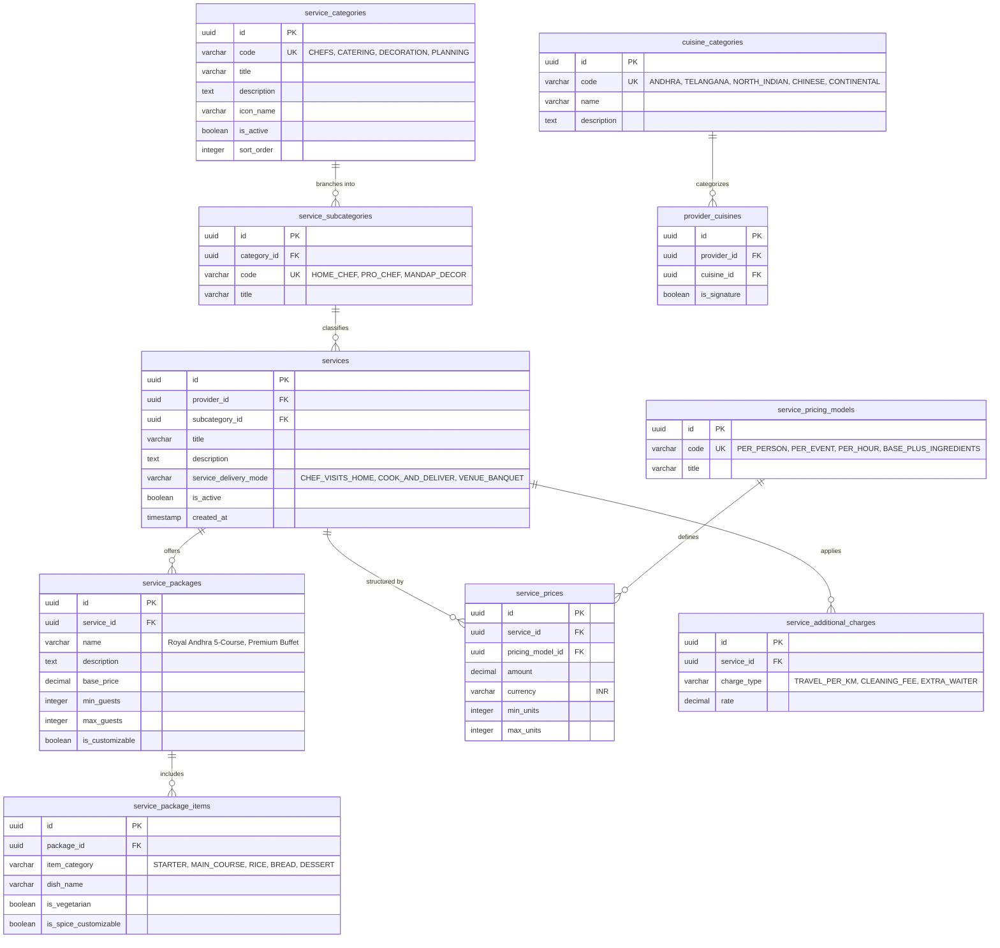
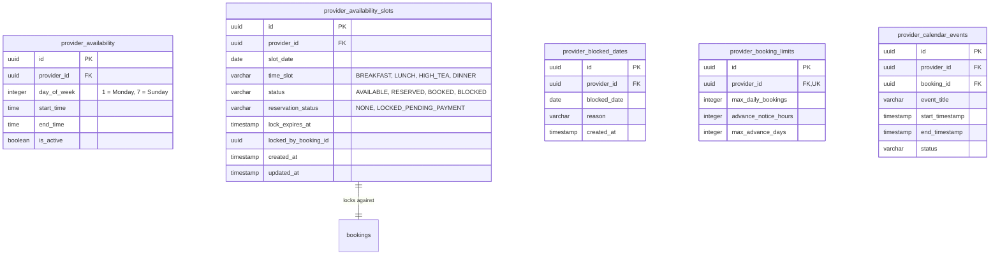
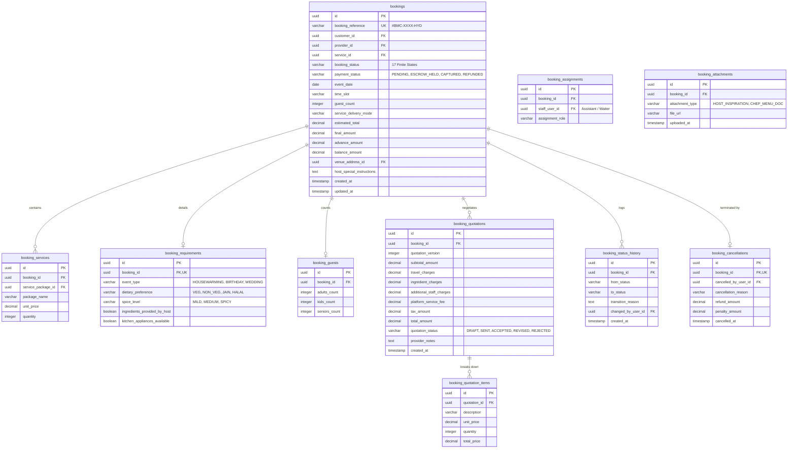
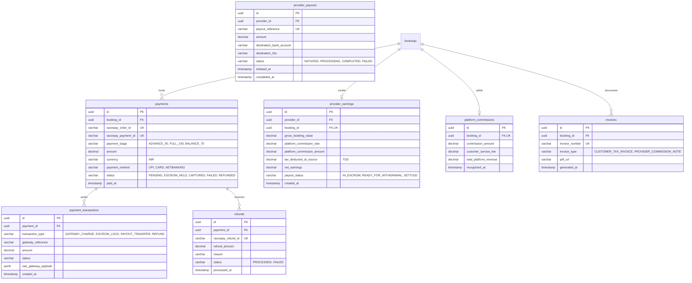

# Entity Relationship Diagram (ERD)

**Project:** Culinary & Event Atelier ("BOOK MY CHEF") — Multi-Service Chef, Catering & Event Services Marketplace  
**Engine:** PostgreSQL 16+ Relational Architecture  
**Primary Key Standard:** UUID v4  
**Audit Standard:** `created_at`, `updated_at`, `deleted_at` (Soft Delete)  
**Total Tables:** 74 Normalized Tables  

---

## 1. High-Level Entity Relationship Diagram

```mermaid
erDiagram
    users ||--o| user_profiles : "has profile"
    users ||--o{ user_addresses : "maintains"
    users ||--o{ user_roles : "assigned"
    roles ||--o{ user_roles : "maps"
    roles ||--o{ role_permissions : "grants"
    permissions ||--o{ role_permissions : "defines"
    
    users ||--o| provider_profiles : "registers as"
    provider_profiles ||--o{ provider_roles : "serves as"
    provider_profiles ||--o{ provider_verifications : "undergoes"
    provider_profiles ||--o{ provider_documents : "attaches"
    provider_profiles ||--o{ provider_portfolio : "showcases"
    provider_profiles ||--o{ provider_service_areas : "covers"
    provider_profiles ||--o{ provider_cuisines : "cooks"
    cuisine_categories ||--o{ provider_cuisines : "categorizes"
    
    provider_profiles ||--o{ services : "publishes"
    service_categories ||--o{ services : "organizes"
    services ||--o{ service_packages : "bundles"
    service_packages ||--o{ service_package_items : "contains"
    services ||--o{ service_prices : "priced via"
    service_pricing_models ||--o{ service_prices : "defines model"
    
    provider_profiles ||--o{ provider_availability : "configures"
    provider_profiles ||--o{ provider_availability_slots : "schedules"
    provider_profiles ||--o{ provider_blocked_dates : "blocks"
    
    users ||--o{ customer_favourites : "saves"
    users ||--o{ bookings : "creates (as host)"
    provider_profiles ||--o{ bookings : "receives (as provider)"
    
    bookings ||--o{ booking_services : "includes"
    bookings ||--o| booking_requirements : "details"
    bookings ||--o{ booking_quotations : "negotiates"
    booking_quotations ||--o{ booking_quotation_items : "breaks down"
    bookings ||--o{ booking_status_history : "tracks"
    bookings ||--o| booking_cancellations : "records"
    
    bookings ||--o{ payments : "paid via"
    payments ||--o{ payment_transactions : "logs"
    payments ||--o{ refunds : "issues"
    bookings ||--o| provider_earnings : "generates"
    provider_profiles ||--o{ provider_payouts : "withdraws"
    bookings ||--o| platform_commissions : "charges"
    
    users ||--o{ reviews : "authors"
    provider_profiles ||--o{ reviews : "evaluated in"
    bookings ||--o| reviews : "reviewed for"
    reviews ||--o{ review_images : "includes"
    provider_profiles ||--o| provider_rating_summaries : "summarizes"
    
    users ||--o{ conversation_participants : "participates"
    conversations ||--o{ conversation_participants : "includes"
    conversations ||--o{ messages : "contains"
    users ||--o{ notifications : "receives"
    
    users ||--o{ admin_audit_logs : "performed by"
    bookings ||--o{ disputes : "disputed in"
```

---

## 2. Exhaustive Modular Database Schema Maps (74 Tables)

### Module A: Identity & Access Management (Tables 01-10)

---

### Module B: Provider Management & Credentials (Tables 11-20)

```mermaid
erDiagram
    provider_profiles {
        uuid id PK
        uuid user_id FK, UK
        varchar professional_name
        varchar business_name
        text bio
        integer experience_years
        varchar avatar_url
        varchar cover_image_url
        varchar verification_status "PENDING, VERIFIED, REJECTED, SUSPENDED"
        boolean is_accepting_bookings
        decimal min_booking_amount
        integer max_travel_distance_km
        decimal base_latitude
        decimal base_longitude
        varchar fssai_license_number
        timestamp fssai_expiry_date
        timestamp verified_at
        timestamp created_at
        timestamp updated_at
    }

    provider_types {
        uuid id PK
        varchar code UK "INDIVIDUAL_CHEF, CATERER, EVENT_AGENCY"
        varchar title
    }

    provider_roles {
        uuid id PK
        uuid provider_id FK
        varchar role_type "PRO_CHEF, HOME_CHEF, CATERER, PLANNER, DECORATOR"
        boolean is_primary
    }

    provider_verifications {
        uuid id PK
        uuid provider_id FK
        varchar verification_type "FSSAI, AADHAAR_KYC, POLICE_BACKGROUND"
        varchar status "SUBMITTED, UNDER_REVIEW, APPROVED, REJECTED"
        text rejection_reason
        uuid verified_by FK "Admin user ID"
        timestamp verified_at
    }

    provider_documents {
        uuid id PK
        uuid provider_id FK
        varchar document_type "FSSAI_CERT, AADHAAR, CHEF_DIPLOMA"
        varchar document_url
        varchar file_name
        varchar verification_status
        timestamp uploaded_at
    }

    provider_experiences {
        uuid id PK
        uuid provider_id FK
        varchar organization_name
        varchar designation
        integer start_year
        integer end_year
        text description
    }

    provider_languages {
        uuid id PK
        uuid provider_id FK
        varchar language_code "EN, TE, HI, TA, KN"
    }

    provider_service_areas {
        uuid id PK
        uuid provider_id FK
        varchar city
        varchar neighborhood_name
        varchar postal_code
        decimal radius_km
    }

    provider_portfolio {
        uuid id PK
        uuid provider_id FK
        varchar media_type "IMAGE, VIDEO"
        varchar media_url
        varchar title
        text description
        varchar dish_category
        boolean is_featured
        integer sort_order
    }

    provider_business_details {
        uuid id PK
        uuid provider_id FK, UK
        varchar legal_entity_name
        varchar gst_number
        varchar pan_number
        varchar bank_account_number
        varchar bank_ifsc_code
        varchar bank_name
        boolean bank_verified
    }

    provider_profiles ||--o{ provider_roles : "holds"
    provider_profiles ||--o{ provider_verifications : "tracked in"
    provider_profiles ||--o{ provider_documents : "attaches"
    provider_profiles ||--o{ provider_experiences : "lists"
    provider_profiles ||--o{ provider_languages : "speaks"
    provider_profiles ||--o{ provider_service_areas : "services"
    provider_profiles ||--o{ provider_portfolio : "contains"
    provider_profiles ||--o| provider_business_details : "owns"
```

---

### Module C: Services, Cuisines & Pricing (Tables 21-30)

---

### Module D: Availability & Concurrency Engine (Tables 31-35)

---

### Module E & F: Bookings, Quotations & Event Tracking (Tables 41-50)

---

### Module G: Finance, Escrow & Settlements (Tables 51-57)

---

### Module H, I & J: Communication, Reviews, Admin & Auditing (Tables 58-74)

```mermaid
erDiagram
    conversations {
        uuid id PK
        uuid booking_id FK
        timestamp created_at
        timestamp last_message_at
    }

    conversation_participants {
        uuid id PK
        uuid conversation_id FK
        uuid user_id FK
        timestamp joined_at
    }

    messages {
        uuid id PK
        uuid conversation_id FK
        uuid sender_id FK
        varchar message_type "TEXT, QUOTATION_OFFER, DISH_PHOTO, LOCATION_PIN"
        text content
        jsonb metadata
        boolean is_read
        timestamp created_at
    }

    notifications {
        uuid id PK
        uuid user_id FK
        varchar notification_type "BOOKING_REQUEST, QUOTATION_RECEIVED, ESCROW_RELEASED"
        varchar title
        text message
        varchar action_url
        boolean is_read
        timestamp created_at
    }

    reviews {
        uuid id PK
        uuid booking_id FK, UK
        uuid customer_id FK
        uuid provider_id FK
        decimal overall_rating
        decimal food_taste_rating
        decimal hygiene_rating
        decimal punctuality_rating
        decimal hospitality_rating
        text review_text
        boolean is_verified_booking
        timestamp created_at
    }

    review_images {
        uuid id PK
        uuid review_id FK
        varchar image_url
        varchar caption
    }

    review_responses {
        uuid id PK
        uuid review_id FK, UK
        uuid provider_id FK
        text response_text
        timestamp responded_at
    }

    provider_rating_summaries {
        uuid id PK
        uuid provider_id FK, UK
        decimal average_overall_rating
        decimal average_food_rating
        decimal average_hygiene_rating
        decimal average_punctuality_rating
        integer total_reviews_count
        integer five_star_count
        integer four_star_count
        integer three_star_count
        integer two_star_count
        integer one_star_count
        timestamp updated_at
    }

    admin_audit_logs {
        uuid id PK
        uuid admin_user_id FK
        varchar action "VERIFY_PROVIDER, FREEZE_ESCROW, OVERRIDE_COMMISSION, SUSPEND_USER"
        varchar entity_type
        uuid entity_id
        jsonb old_values
        jsonb new_values
        varchar ip_address
        timestamp performed_at
    }

    disputes {
        uuid id PK
        uuid booking_id FK
        uuid raised_by_user_id FK
        varchar dispute_category "NO_SHOW, POOR_HYGIENE, FOOD_SHORTAGE, UNEXPECTED_CHARGES"
        text claim_description
        varchar dispute_status "OPEN, UNDER_INVESTIGATION, RESOLVED, DISMISSED"
        uuid assigned_admin_id FK
        decimal refund_awarded
        timestamp created_at
        timestamp resolved_at
    }

    system_settings {
        varchar key PK
        varchar value
        varchar data_type
        text description
        timestamp updated_at
    }

    platform_feature_flags {
        varchar flag_name PK
        boolean is_enabled
        text description
        jsonb rollout_rules
    }
```

